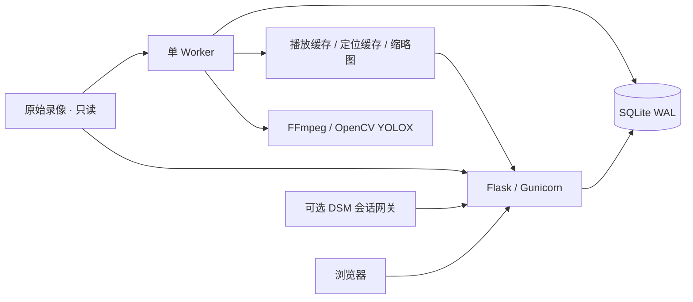

# 架构

`camera_review/catalog.py` 管理索引、版本、短事务、队列和缓存生命周期。文件路径派生稳定 ID；大小或纳秒修改时间变化会生成新的随机 generation，旧任务不能提交到新版本。只有成功完成文件遍历后才标记缺失录像；存储暂时离线不会清空索引。

`worker.py` 是唯一媒体任务执行者。优先处理用户播放，再处理预取、封面和可断点人物分析；分析遇到播放请求会让出资源。不要横向扩容 worker，否则恢复清理与任务调度不再满足单 worker 前提。

`media.py` 通过 FFmpeg 对不完整定位表建立按版本复用的 stream-copy MP4，再按需生成 H.264/AAC 兼容短片。原片输入只读，不整体重编码；下载仍返回原始文件。YOLOX 每次只判断抽样帧的人物出现，不识别人脸身份。`motion.py` 可过滤静态场景的重复推理，解码仍执行。

`web.py` 处理同源 API 和独立密码会话。DSM 网关对每次请求调用原生认证，签署请求绑定的 HMAC 身份；DSM Cookie 和 SynoToken 不传入应用容器。详细契约见 [API](../API.md) 和 [DSM 令牌接入](dsm-native-token-bridge.md)。

`static/timeline.js` 计算北京时间定位、覆盖、空档和跨文件接续；`static/app.js` 管理请求和至多两个 video 元素。已加载缓冲区直接跳转；下一片提前转码和加载，准备好才替换当前画面。冷缓存、较慢网络和 CPU 转码仍可能等待，不保证无缝音频。

缓存仅删除命名规则匹配的应用生成文件。失败或取消只删除本次拥有的 partial；启动恢复清理遗留 partial，扫描清理旧版本/孤立 MP4，完成缓存按最近访问淘汰。事件 JPEG 和数据库有独立生命周期，不纳入 MP4 预算；缓存不能作为录像保留策略。
